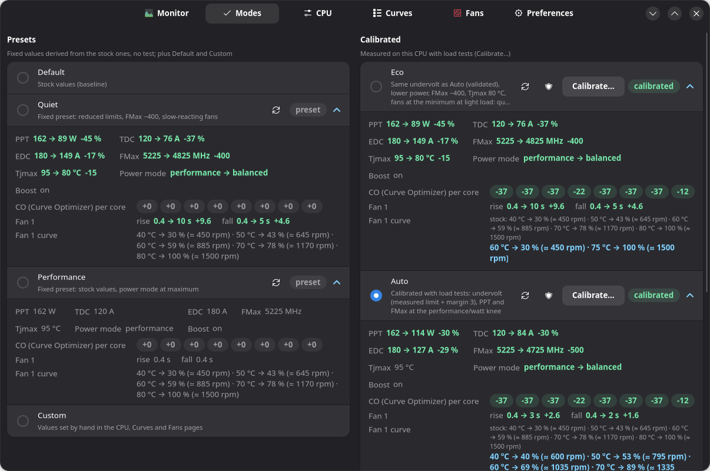
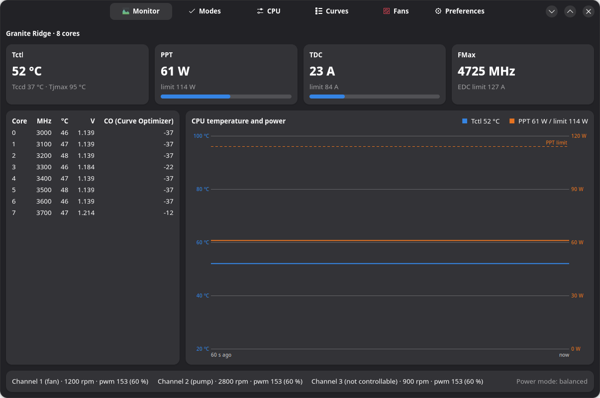
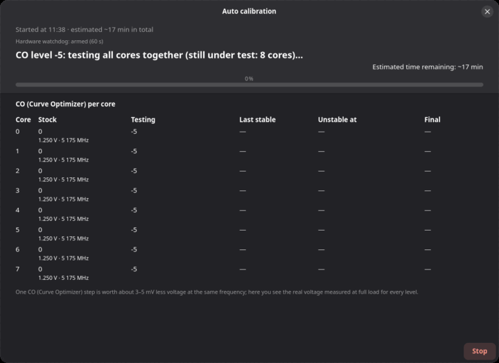
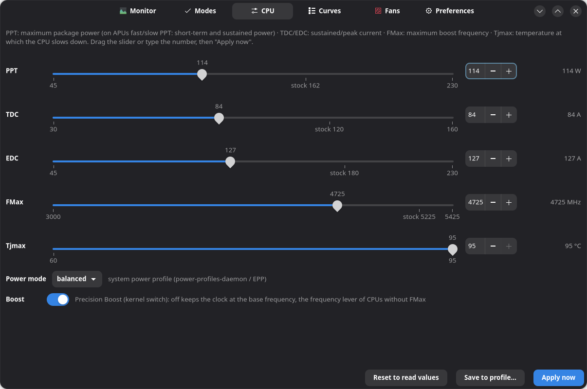
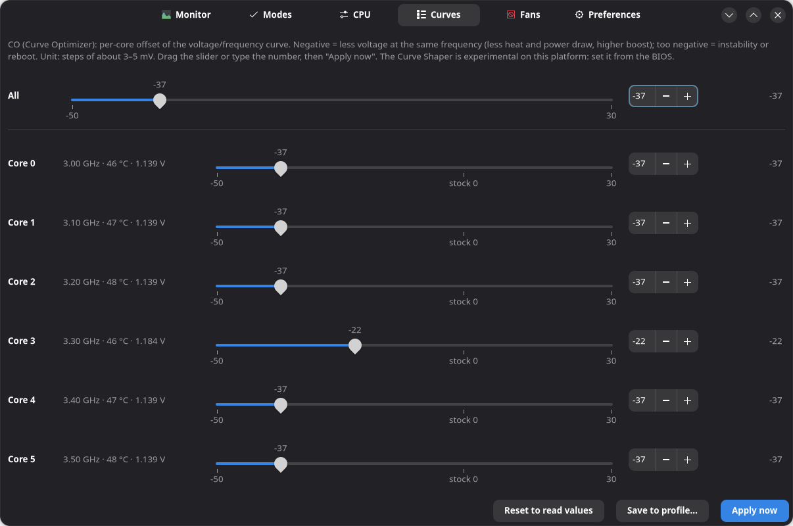
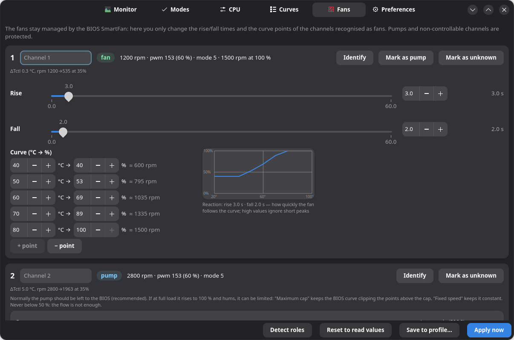
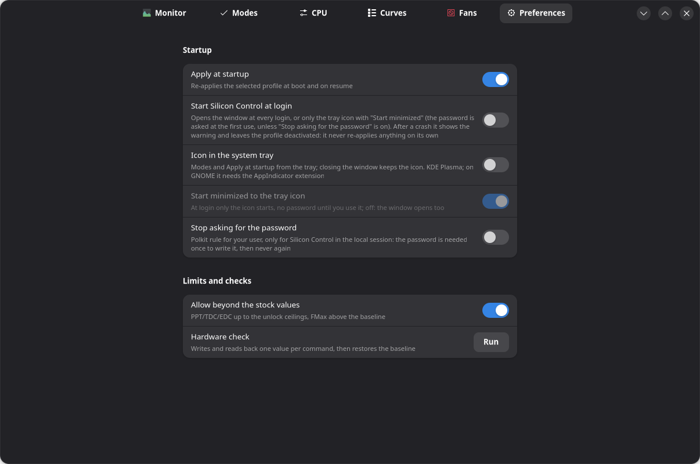

# Silicon Control

Control of the processor on Linux — power limits, boost frequency, temperature limit, undervolt and fans —
with automatic per-chip calibration and protection after a crash. Successor of Ryzen Control: so far it
supports AMD Ryzen processors only; Intel and the other CPUs (through the kernel's generic interfaces) are
in development (plan: `docs/plans/2026-10-13-silicon-control.md`).

On AMD Ryzen (Ryzen 9000 desktop verified; Ryzen 1000–7000 desktop and the APUs of desktops, mini PCs and
laptops expected: see [Processors](#processors)): per-core Curve Optimizer and Curve Shaper, PPT/TDC/EDC
limits (fast/slow PPT on the APUs), boost frequency (FMax), maximum temperature (Tjmax), power profile and
motherboard fans, with profiles applied at boot.

> **Warning.** Experimental software that talks directly to the processor's SMU.
> Developed and tested on a single system: Ryzen 7 9800X3D, ASUS ROG STRIX X870E-H, Fedora 44.
> Processors outside the [table](#processors) are refused. A Curve Optimizer that is too
> negative can reboot the system (no damage, but unsaved work is lost): read "Safety" before
> using it.

Status: the code of Ryzen Control 0.8.0 under the new name — `siliconctl` helper/CLI, systemd services,
driver via DKMS, RPM package, fans, GTK4 GUI, calibrations, per-family support for other Ryzen
CPUs, system tray icon on the development system; deb and Arch packages built and install-tested in
containers; APUs and laptops tested on simulated hardware only (see `docs/plans/`).



## Processors

Every family has its own SMU allowlist (`FAMILIES` at the top of `siliconctl`, from ZenStates-Core
and ryzen_smu): a family that is not there is refused in full, and a function the family does not
have is refused, its command never sent. A family is **verified** once a `hwtest` on real hardware
has written and read back each of its functions; until then it is **expected**: same guarantees
(values ≤ the BIOS ones, readback of every write, crash-guard), but nobody has tried it yet, and
`siliconctl status` and the Monitor page say so.

| Processors | Family (codename) | Status | Functions |
|---|---|---|---|
| Ryzen 9000 desktop: 9800X3D | Granite Ridge (23) | **verified** on 9800X3D, SMU 98.81.0, PM table 0x620105 | Curve Optimizer, FMax, PPT/TDC/EDC, Tjmax, voltage and temperature per core, all calibrations; Curve Shaper experimental (not verifiable) |
| Ryzen 9000 desktop: 9600X, 9700X, 9900X, 9950X, 9900X3D, 9950X3D | Granite Ridge (23) | expected | as above; the limits are read at the PM table offsets measured on 0x620105, voltage and temperature per core only with that version; the 6-core CCDs (9600X, 9900X, 9900X3D) take the core positions from the fuses |
| Ryzen 7000 desktop: 7600X … 7950X3D | Raphael (20) | expected | Curve Optimizer, FMax, Eco and Boost calibrations; PPT/TDC/EDC/Tjmax and Auto refused (no verified map of the limits in its PM table) |
| Ryzen 5000 desktop: 5600X … 5950X, 5800X3D | Vermeer (12) | expected | Curve Optimizer (−30..+30), PPT/TDC/EDC/Tjmax (PM tables 0x3808xx/0x3809xx), all calibrations, Auto on the PPT alone; no FMax (Zen 3 has no command for it); the core positions always come from the fuses; on the 5800X3D the BIOS may lock the power limits (the CO still works) |
| Ryzen 3000 desktop: 3600 … 3950X | Matisse (4) | expected | PPT/TDC/EDC/Tjmax (PM tables 0x240803/0x240903), Quiet and Performance, Quiet also turns the boost off; no Curve Optimizer, so no calibrated modes |
| Ryzen 1000/2000 desktop | Summit Ridge (9), Pinnacle Ridge (10) | expected | boost switch, power profile and fans only: no SMU command (no Curve Optimizer, no readable limits); Tdie instead of Tctl on the X models with an offset |
| APUs: desktop Ryzen 4000G/5000G/8000G; mini PCs and laptops with Ryzen 4000/5000/6000/7040/8040 U/H/HS, AI 300, AI Max | Renoir (2), Lucienne (17), Cezanne (14), Rembrandt (11), Phoenix (21), Hawk Point (24), Strix Point (22), Strix Halo (26) | expected | fast/slow PPT, Tjmax and TDC/EDC where the PM table is mapped, read back from it; STAPM shown read only; Quiet (60 % of fast/slow, boost off) and Performance. No Curve Optimizer (no verified readback on APUs), no FMax, so no calibrated modes. In a laptop, the [laptop rules](#laptops) |
| Raven Ridge, Picasso, Dali, Van Gogh (Steam Deck), Krackan… | | not supported | no readable PM table through ryzen_smu, or an unmapped one |
| HX laptops: 7945HX, 9955HX … | Dragon Range, Fire Range (reported by the driver as Raphael / Granite Ridge) | not supported | refused when the machine has a system battery (a laptop): its firmware and battery limits are not handled |
| Threadripper, EPYC | — | not supported | other interface (HSMP), out of scope |

Fans depend on the motherboard (Nuvoton nct67xx chip), not on the processor.

### Adding your processor

If your processor is *expected*, one check on your machine moves it to *verified*. It takes a few
seconds and restores everything, but save your work first: it lowers the Curve Optimizer of one
core by 3 steps for a moment.

1. Install (below): the service loads the driver and reads the BIOS values of this boot.
2. `sudo siliconctl status` — the first line shows family, cores, SMU and PM table version.
3. `sudo siliconctl hwtest` (or Preferences → Hardware check): each command is written slightly
   away from the BIOS value, read back and brought back; the last line is `esito ok`, or
   `esito FAILED` with `error:` on the step that failed. Functions the family does not have are
   `skipped`.
4. Open an issue with the output of `lscpu | grep 'Model name'`, `sudo siliconctl status` and
   `sudo siliconctl hwtest`.

A family that is not in the table is refused before any SMU command (`unsupported CPU (codename
N…)`). Adding it needs its command IDs and PM table map from a verified source, a fake variant in
the selftest (`SILICONCTL_FAKE_FAMILY`) and then the same `hwtest`: open an issue with the codename
(`cat /sys/kernel/ryzen_smu_drv/codename`) and the PM table version.

### Laptops

A laptop's firmware owns its power limits: it has its own for AC and for battery, and amd-pmf or the
embedded controller rewrites them at every platform profile or power supply change, after sleep and on
some models periodically. Only the APUs above are accepted in a laptop (a system battery is present);
then:

- The baseline records the power source of the boot (`# source ac` or `battery`) and CPU values are
  written only on that source. On the other one the firmware's limits apply until you are back on it or
  reboot: CPU writes and `apply` are refused with the reason, and Default only resets fans, power profile
  and boost and deselects the mode (the CPU values are not written).
- A mode's power profile and boost are applied before its limits, so the platform profile change does not
  wipe them.
- With "Apply at startup" on and a mode that changes a limit, `siliconctl reapply` runs every 10 s
  (`siliconctl-reapply.timer`) and when an AC adapter or a USB-C charger is plugged or unplugged (udev rule):
  the limits the firmware changed are written again, with the usual readback and crash-guard markers;
  nothing is written when nothing changed. Three corrections within two minutes mean the firmware keeps
  overriding them: re-applying stops (Monitor, tray tooltip, `siliconctl status`) until the mode is applied
  again or the next boot. A limit set by hand, or a new save of the selected mode's profile, stops it too
  until the next apply. On a desktop or a mini PC the timer finds no flag file and starts nothing.

Limits: the stock values are those of the platform profile active at boot, so Performance is capped at
them; a mode holds fixed numbers, so one created on AC may exceed the battery's stock values and be
refused on a boot on battery (Regenerate it there). Nobody has tried it on a real laptop yet: after a boot
on AC and one on battery run `sudo siliconctl hwtest`; then, with a mode applied at startup, plug and
unplug the charger and look at `cat /run/siliconctl/reapply.json` and
`systemctl status siliconctl-reapply.service`.

## Installation

### Fedora (RPM)

```sh
make rpm                                   # requires rpm-build, rpmdevtools, git
sudo dnf install dist/silicon-control-*.rpm
```

A single package that does everything by itself: it builds the `ryzen_smu` module via DKMS for
every installed kernel (`dkms.service` rebuilds it at every update) and starts the service,
which loads the module and reads the baseline (no profile is applied).

**Secure Boot**: the module must be signed with a key enrolled in MOK. If the akmods key is
already enrolled on the system (typical with RPM Fusion's NVIDIA drivers), DKMS reuses it
automatically: no manual step. Otherwise the package says so at the end of the installation
and a one-time enrollment is needed — it is a Secure Boot limitation (it requires physical
confirmation at reboot), not something software can work around:

```sh
sudo mokutil --import /var/lib/dkms/mok.pub      # asks for a temporary password
sudo reboot                                       # MOK Manager: Enroll MOK → Continue → password
```

Check (all automatic, reversible, a couple of seconds):

```sh
sudo siliconctl status                        # BIOS values, "Baseline of this boot"
sudo siliconctl hwtest                        # writes and reads back every command close to the baseline, then restores it
```

### Debian / Ubuntu (deb)

Debian 13 or Ubuntu 24.04 and newer (libadwaita ≥ 1.5). The `.deb` is attached to every release, or:

```sh
make deb                                   # in a Debian container with podman → dist/silicon-control_<version>_all.deb
sudo apt install ./dist/silicon-control_*_all.deb
```

On Debian/Ubuntu itself: `cp -r packaging/debian debian && dpkg-buildpackage -us -uc -b`. DKMS builds
`ryzen_smu` for the installed kernels — install the kernel headers (`linux-headers-amd64` on Debian,
`linux-headers-generic` on Ubuntu) — and the services are enabled, `siliconctl.service` started.
Secure Boot: Ubuntu signs DKMS modules with its own MOK key and asks to enroll it; on Debian
`sudo mokutil --import /var/lib/dkms/mok.pub` and a reboot, as on Fedora.

### Arch Linux

The package is attached to every release, or:

```sh
make arch                                  # in an Arch container with podman → dist/silicon-control-<version>-1-any.pkg.tar.zst
sudo pacman -U dist/silicon-control-*.pkg.tar.zst
sudo systemctl enable --now siliconctl.service siliconctl-resume.service siliconctl-reapply.timer
```

On Arch itself `packaging/PKGBUILD` builds the GitHub tag (`makepkg -si` in `packaging/`). The DKMS
pacman hook builds the module: install `linux-headers` (or the headers of your kernel).

Both packages are built, checked with lintian / namcap, installed, run the selftest and removed in
Debian 13, Ubuntu 24.04 and Arch containers (`packaging/build-deb.sh`, `packaging/build-arch.sh`, also
in the release workflow); they have not been used on real Debian, Ubuntu or Arch hardware yet.

### Other distributions

With `dkms`, the kernel headers, `python3 >= 3.9`, PyGObject, GTK 4, libadwaita ≥ 1.5, `polkit` and
`systemd` installed:

```sh
sudo make install && sudo make dkms
sudo systemctl enable --now siliconctl.service siliconctl-resume.service siliconctl-reapply.timer
```

To remove: `sudo make uninstall`.

## Usage (GUI)

Open **Silicon Control** from the application menu (or run `silicon-control`). The first action that
needs root asks for the administrator password once per session; "Stop asking for the password"
in Preferences removes even that one. The screenshots below come from the fake backend
(`make screenshots`), so the values are illustrative.

**Monitor** — the CPU family and its active cores on top (with a note when the family has not
been verified on hardware yet), Tctl and per-core temperature, PPT and TDC against their limits,
MHz, voltage and Curve Optimizer per core, a 60 s graph of Tctl (blue, °C) and PPT (orange, W, its
limit dashed), fan speeds and power mode. Every per-core view lists only the active cores.



**Modes** — one click switches between stock values (Default), the fixed presets (Quiet,
Performance), the modes calibrated on this CPU (Eco, Auto, Boost) and your own values (Custom).
Every profile lists its values, fans included: green is more conservative than stock, red more
aggressive, grey unchanged. Boost needs "Allow beyond the stock values" (Preferences): until then
it is shown dimmed, and hovering it says why.

**Calibration** — "Calibrate…" on Auto or Boost measures this CPU: the Curve Optimizer limit of
every core under load, a final pass on all cores, then the performance/watt knee (Auto) or the
gain over stock (Boost), with the remaining time and the real voltage measured per core. Eco
reuses the undervolt that Auto or Boost validated, so it is usually ready at once. At the end you
choose: discard, save, or save and apply. Save your work first: an unstable level can reboot the
PC (see "Safety").



**CPU** and **Curves** — the same values by hand: PPT/TDC/EDC, FMax, Tjmax and power mode, then
the Curve Optimizer for all cores or one by one. "Apply now" writes them (each value is read
back), "Save to profile…" keeps them.





**Fans** — the BIOS SmartFan stays in charge: you only change how fast each fan follows its
curve (rise/fall) and the curve points, with the estimated rpm. Pumps and non-controllable
channels are protected; the pump can only be left to the BIOS (recommended), capped, or set to a
fixed speed (never below 50 %). Channels with an unknown role are grouped in a collapsed
"Unknown channels" section at the end of the page (listed in Monitor only while it is open); its
state is remembered.



**Preferences** — "Apply at startup" re-applies the selected profile at every boot and resume,
never after a crash; choosing Default leaves it on (nothing is applied until you pick another mode), the
crash warning's "Stay on Default" turns it off; "Start Silicon Control at login" opens the window at every login; "Stop asking
for the password" writes the polkit rule described in "Safety"; "Allow beyond the stock values"
raises the PPT/TDC/EDC and FMax ceilings (unlock); "Hardware check" writes and reads back one
value per command, then restores the baseline.



**System tray** — Preferences → "Icon in the system tray" (or `silicon-control --tray`): an icon in
the panel, bottom right (KDE Plasma natively; on GNOME it needs the AppIndicator extension). Left
click opens the window; the right-click menu has the modes (the active one ticked; a calibrated mode
not calibrated yet, or Boost without the unlock, greyed out), the custom calibrations, "Apply at
startup", "Open Silicon Control" and "Quit"; after a crash the choice Reactivate / Stay on Default
comes first and the icon asks for attention. The tooltip shows Tctl (read without root) and, once
`siliconctl serve` runs anyway, the PPT. With the tray on, closing the window keeps the icon, and
"Start minimized to the tray icon" (on by default) decides what "Start Silicon Control at login" opens:
only the icon — no password until you pick something from the menu, then once per session as for
the window — or the window as well.

## Usage (CLI)

All commands share the same grammar on the CLI, in profile files and in the GUI. A profile is
the stock state (the baseline captured at boot) with its own lines on top: whatever it does not set
— a fan curve, a limit — is applied and shown at its stock value, so switching mode never leaves
the previous mode's fans or limits behind. The pump is never part of a mode.

```sh
sudo siliconctl status                 # current state and baseline
sudo siliconctl co 7 -15               # Curve Optimizer of core 7; `co all -10`; `co v0 … v7`
sudo siliconctl ppt 120                # limits: ppt (W), tdc (A), edc (A)
sudo siliconctl slow 20                # APUs: sustained (slow) and short-term (fast) PPT, W
sudo siliconctl fmax 5000              # maximum boost frequency (MHz)
sudo siliconctl tjmax 85               # maximum temperature (°C), never above the baseline
sudo siliconctl power balanced         # power-saver | balanced | performance
sudo siliconctl boost off              # Precision Boost through the kernel (cpufreq), no SMU: on | off
sudo siliconctl default                # everything back to the base (BIOS) values, no mode selected
sudo siliconctl reapply                # laptops: the limits the firmware changed, written again (the timer runs it)
sudo siliconctl trust on|off|status    # polkit rule: your user starts Silicon Control without a password
sudo siliconctl hwtest                 # reversible test of every command with readback
```

Profiles (`/etc/siliconctl/profiles/<name>.conf`, one line per command, `#` comments):

```sh
sudo siliconctl profile save quiet "co all -15" "ppt 88" "tdc 75" "edc 150" "fmax 4800" "power balanced"
sudo siliconctl apply quiet            # apply now
sudo siliconctl use quiet && sudo siliconctl autostart on     # apply at every boot and after resume
sudo siliconctl profile list | show quiet | delete quiet
```

Beyond the factory values (PPT up to 230 W, TDC 160 A, EDC 230 A, FMax +200 MHz) only after
`sudo siliconctl unlock on`, which prints a warning. Tjmax never exceeds the baseline.

### Fans (motherboard, Nuvoton nct67xx chip)

```sh
sudo siliconctl fan enable             # loads nct6775 and makes it permanent; if the chip does not show up because of an
                                     # ACPI conflict it adds acpi_enforce_resources=lax (grubby) and asks for a reboot
sudo siliconctl fan status             # channels, rpm, pwm, step, curve, role
sudo siliconctl fan autodetect         # ~30 s per channel under load: assigns the roles ventola (fan) / pompa (pump) / non-controllabile
sudo siliconctl fan 1 step 10000 5000  # SmartFan reaction delay (ms, ramp up/ramp down): ignores short spikes
sudo siliconctl fan 1 curve 40:77 60:150 75:255   # temperature:pwm points (pwm >= 51, last one 255 within 125 °C)
sudo siliconctl fan 2 pump max 70      # pump: BIOS curve capped at 70 %; `pump 65` = fixed; `pump auto` = BIOS
sudo siliconctl fan identify 2         # 100 % for 5 s to physically recognise the channel
sudo siliconctl fan name 1 "top radiator"; sudo siliconctl fan role 3 pompa   # by hand you can only demote
sudo siliconctl fan disable
```

Writes go only to channels classified **ventola** (fan) by `fan autodetect` (physical test:
channel at 40 % for 20 s under load; the pump raises Tctl by degrees in seconds, a fan does
not); the pump and the channels that do not respond to PWM stay read-only. The only exception,
at the user's choice, is for the pump: **maximum cap** (`fan N pump max 70`: BIOS curve with
the points above the cap reduced, minimum 50 %) or fixed speed (`fan N pump 65`), because the
BIOS curve drives it to 100 % under sustained load and it hums; `fan N pump auto` restores the
BIOS. In profiles: `fan <N> step …`, `fan <N> curve …`, `fan <N> pump auto|max <pct>|<pct>`.

### Modes and automatic calibration

From the GUI (Modes page) or the CLI. Fixed presets (no test): **Default** = BIOS values,
**Quiet** = limits ×0.55/0.63/0.83, FMax −400, Tjmax 80, fans 10 s/5 s (on Ryzen 1000–3000, which
have neither Curve Optimizer nor FMax, also the boost off), **Performance** =
factory values with power at maximum. If the BIOS reports the motherboard's limits instead of the
CPU's (PBO "Enabled" on many boards: PPT 1000 W and the like), ratios of them mean nothing: Quiet
and Eco use AMD's 65 W Eco mode values (88 W / 75 A / 150 A on AM5, 88 / 60 / 90 on AM4) and Auto
is refused with the reason (set PBO to Auto/Disabled, or Advanced with your own limits). Modes **calibrated on the hardware** with load tests
(**Eco**, **Auto**, **Boost**): the search for the per-core CO stability limit is a single one,
shared and saved (`/var/lib/siliconctl/co_limits.json`, reused by later calibrations), and the three
modes use the same margin (+3), so the same validated undervolt.

```sh
sudo siliconctl preset quiet|performance|eco|auto|boost   # creates the profile from the factory values (placeholder)
sudo siliconctl autotune estimate eco              # estimated duration (0 s when Eco reuses a validated final pass: eco_from)
sudo siliconctl autotune start eco|auto|boost [name=<profile>] [target=70 colimit=-40 margin=3 step=90 parallel=1 reuse=1 fans=0|1|2 single=1 watchdog=1]
sudo siliconctl autotune step                      # one test at a time; repeat until phase == done
sudo siliconctl autotune verify auto [minutes=60]  # long stability test of a saved profile; `autotune finish` stops it keeping the result
sudo siliconctl autotune status | abort            # abort stops immediately, even a step in progress
sudo siliconctl autotune save [apply]              # at phase == done: writes the proposed profile (and applies it); abort discards it
```

When the calibration is over the CPU goes back to the factory values and the profile is only
**proposed**: you choose whether to cancel, save (the profile appears in Modes, not active) or
save and apply.

**Custom calibrations** (Modes → Calibrated → Custom → "Calibrate…"; CLI `name=<profile>`): pick the
base mode (Eco, Auto, Boost) and the name of a new profile, then the usual dialog. The result is
saved under that name and listed in the Custom row (apply, Verify…, delete): the Eco, Auto and Boost
profiles are never overwritten, and a new search of the CO limit stays in the custom calibration —
the shared measurement the three modes reuse is untouched. So a working Auto stays as it is while you
try other parameters. A custom calibration based on Boost follows Boost's unlock rule. Only here,
"Retry from the last stable value, ignoring the crash" (`retry=1`): when the reused measurement ended
with a crash, or a final pass failed, the final pass normally starts 3 steps further away and skips
what failed; with it on, it starts again from the last stable value + margin (a freeze is possible:
the watchdog resets the PC and the new crash is recorded).

**Verify…** (shield button on a saved calibrated profile; CLI `autotune verify`): hours of load on the
saved profile without changing anything, like CoreCycler or Ryzen Master's "Validate": each core alone
with one thread, then all cores together, in iterations for the chosen time (30 min – 8 h). At the
end either "passed", or a proposal with only the cores that failed raised by 3 (Cancel / Save / Save
and apply). Stop keeps the partial result. Without a choice the state stays on disk and the GUI offers it again at the
next start.

From the GUI: Modes → "Calibrate…" on Eco, Auto or Boost, then "Automatic" (default values) or
"Choose the values…"; at the end the buttons **Cancel / Save / Save and apply**. In both cases you choose how much the
mode touches the fans (`fans`), only on the channels recognised as fans: 0 BIOS untouched;
1 moderate (Auto and Boost default): rise 3 s / fall 2 s and the BIOS curve raised by 10 % with
full speed at 100 °C — the BIOS curves reach 100 % only at 125 °C, so under load the fans hardly
react; 2 quiet (Eco default): 10 s / 5 s, BIOS minimum up to `target` −10 °C, 100 % at Tjmax −5 °C
(`target` only shapes this curve).
The curve always starts from the BIOS one captured at boot, so a recalibration never raises it twice.
By default the
cores are tested **all together** at every CO level (one worker per core, ~8× faster;
`parallel=0` = one core at a time, which attributes even a reboot with certainty). During the
tests the GUI shows the estimated remaining time, the real voltage measured per core at every
level and how many mV one CO step is worth on this CPU.

- **Auto**: searches for the stable negative Curve Optimizer (steps of −5 down to `colimit`,
  load phases: the heaviest method, mixed methods with verify, 50 %, single bursts for the
  maximum boost; MCE error check), CO = last stable + 3, final pass on all cores, then the
  performance/watt knee: sweep of PPT (multi-thread) and FMax (single-thread) measuring
  stress-ng bogo-ops/s and RAPL power, choosing the lowest value that loses at most `loss` %
  (default 10) against the maximum.
- **Eco**: the same validated undervolt with the Eco preset values: limits ×0.55/0.63/0.83
  (≈ AMD 65 W class), FMax −400, Tjmax 80, balanced power, quiet fans — quiet under heavy load.
  Every successful final pass is recorded in `co_limits.json` (`final_passed`): if one covers
  Eco's CO, Eco is proposed at once with no load test; with only the per-core limits it runs the
  final pass; on a fresh install (no measurement yet) the full search and the final pass.
- **Boost** (needs `siliconctl unlock on`, "Allow beyond the stock values" in the GUI): CO =
  limit + 3, limits at the unlock ceilings (230 W / 160 A / 230 A) and FMax +200 MHz, power at
  maximum; measures the MT/ST gain against stock. Without the unlock siliconctl refuses `preset`,
  `autotune start`, `use` and `apply` for boost, and `unlock off` is refused while Boost is the
  selected mode (switch mode first).

The CO search uses as the first phase of every level the heaviest stress-ng method on this CPU
(probed at start with factory CO); measurements from earlier versions, taken without this load,
are not reused. The **final pass** (all cores at the proposed CO) starts with the stress-ng
method that draws the most power on this CPU, at full load for 60 s with verify, then 100 s
full / 50 % / 10 %; then, with `single=1` (default; a switch in the first calibration dialog, so it is chosen at every
start, also in automatic mode), **each core alone** with one
thread for 45 s and a load that comes and goes: a too-negative CO fails at the highest single-core
boost, which all-core loads never reach (CoreCycler's lesson); a core that fails alone is raised
alone (+3) and the final pass repeated. If it fails, or if in a later phase (knee, benchmark) a load dies, an
MCE error appears or the system freezes and is rebooted, the combination is unstable: +3 on all
cores and the final pass repeated (3 attempts at most). If the search itself ends with a system
freeze, the margin gets an extra +3: the "stable" level below the crash one was tested only for
`step` seconds. Failed combinations stay in `co_limits.json` and later calibrations do not
retry them. After a forced reboot the interrupted step is marked unstable as soon as
`siliconctl.service` starts, before any choice in the GUI (Resume or Cancel). Result on the
development 9800X3D: with the heaviest method in the search the per-core limit is −35 (−40 froze
the system), and the final pass at −29 on all cores is stable; one CO step is worth ≈ 3.4 mV.

**Hardware watchdog**: while a calibration or a verification runs from the GUI, `siliconctl serve` hands
the motherboard watchdog (e.g. the SP5100 TCO timer) to systemd for the duration of the run
(`RuntimeWatchdogUSec` = 60 s): PID 1 pings it as long as the system lives. On Ryzen 9000 a
too-negative CO freezes the PC instead of rebooting it: with the watchdog the board resets by itself
within 60 s, and the calibration resumes with that step marked unstable (proven on the development
board). If only Silicon Control dies or is killed, nothing resets: the step it was running counts as a
crash when it starts again, the CO under test goes back to the stock value, and the watchdog it left
with systemd is released. It is never taken if it could not be stopped again (`nowayout`), if systemd
already drives it (`RuntimeWatchdogSec` set by you: the PC is protected anyway), if another program
holds it, or with `watchdog=0`; the calibration window shows its state.

**Warning**: an unstable CO can reboot the PC during the calibration (no damage, unsaved work
lost). The state is on disk: at reboot the interrupted step is marked unstable and the
calibration resumes. Duration from scratch ~25–40 min (search and final pass, plus the knee or the
bench); with the limits already measured ~7 min plus the knee or the bench; Eco covered by a
recorded pass: immediate. An Eco calibration left halfway by Ryzen Control before 0.4.4 (phase
`fmax`) cannot be resumed: discard it.

**Curve Shaper**: experimental and effectively disabled. On the 9800X3D with SMU 98.81.0 the
write command (RSMU 0xA6) answers OK but the read command (0x84) returns only zeros or the
argument itself, so no write can be verified: `shaper` stays out of profiles and baseline
(`shaper raw` / `shaper probe` are only for investigation). The Curve Shaper has to be set from
the BIOS.

## Safety

- No voltage command, ever: no SoC/VDDIO/VDDG, no fixed VID, no OC mode, no PBO scalar, no SMN
  writes. Only the allowlisted IDs are sent (CO, limits, FMax, Tjmax, Shaper, reads) and every
  value is a *limit* that the firmware keeps enforcing.
- The **baseline** (BIOS values) is read at every boot before any change and is the ceiling of
  every value. Without a baseline of this boot no CPU write is accepted.
- Every write is verified by reading the value back; if it does not match, one retry, then
  restore of the base value and error.
- The Curve Optimizer addresses a core by its physical position in the CCD, while Linux lists
  only the enabled cores. With complete CCDs (8 cores) the positions are 0–7 in order. With
  disabled cores (e.g. 9600X, 9900X, 7600X) the positions come from the core fuses, read through
  the driver's `smn` file — reads only, only at the fuse addresses of the CPU family — and are used
  only if they agree with the system topology; otherwise the per-core CO is refused. On Ryzen 5000
  the fuses are always read: an 8-core part can sit on the second CCD of a two-CCD package.
- **Crash-guard**: `siliconctl.service` writes the markers `dirty` (boot in progress) and `active`
  (state modified) *before* touching the SMU and removes `dirty` at clean shutdown. If both
  exist at the next boot, the system crashed: the CPU profile is **not reapplied**,
  `/var/lib/siliconctl/crashed` is written, a notification arrives at login (one click opens
  Silicon Control) and you decide (`siliconctl crashed clear` + `autostart on` to reactivate, or stay on the BIOS values).
  The "Start Silicon Control at login" switch (Preferences) only adds a user XDG autostart entry
  (`~/.config/autostart/`): the window opens at login with the pkexec prompt and, after a
  crash, shows the warning with Reactivate / Stay on Default. Reapplying at boot remains the
  exclusive job of `siliconctl.service` (`autostart` ∧ no crash): the GUI applies nothing.
  "Stop asking for the password" (Preferences, `siliconctl trust on`) writes
  `/etc/polkit-1/rules.d/50-silicon-control.rules`: your user, in the active local session,
  starts `pkexec siliconctl serve` without authenticating. It applies only to this action, it is
  not a generic sudo; in exchange every program run as your user can change limits, CO and fans
  (within siliconctl's ceilings). `trust off` removes the rule.
- Total escape hatch: at boot, in GRUB, press `e` and add `siliconctl.off` to the kernel line:
  the service does not start and the module is not loaded (it is blacklisted, only the service
  loads it).
- Laptops: CPU values are written only on the power source the baseline was captured on (the firmware's
  limits for battery and AC differ); the profile's limits are written again after the firmware's rewrites,
  and no longer once it keeps overriding them ([Laptops](#laptops)).
- Everything is volatile: a reboot returns to the BIOS values.

## Hardware verification (phase 1 checklist)

1. `dkms status` installed; `modinfo -F signer ryzen_smu` (akmods key or enrolled DKMS key);
   `systemctl status siliconctl` active; `cat /sys/kernel/ryzen_smu_drv/codename` = 23.
2. `sudo siliconctl status` = BIOS values; `sudo siliconctl hwtest` with result `ok` (every command
   written, read back and brought back to the baseline). Result on the 9800X3D / SMU 98.81.0:
   CO, FMax, PPT, TDC, EDC, Tjmax ok; Curve Shaper not verifiable (see above).
3. Crash-guard: harmless profile (`ppt 150`) with autostart; `sync; echo b | sudo tee
   /proc/sysrq-trigger` → at boot `siliconctl crashed` populated, `status` = baseline,
   notification at login; `systemctl restart siliconctl` → baseline unchanged; clean reboot →
   profile applied; suspend/resume → profile still applied; boot with `siliconctl.off` →
   module not loaded.

## Development

```sh
make check          # selftest (fake backend), layout, systemd units, desktop, metainfo
make driver-check   # builds the driver in a temporary copy (kbuild does not accept spaces in the path)
make rpm            # tarball from HEAD + RPM in dist/
make screenshots    # README screenshots: the GUI on a fresh fake backend (needs a display)
SILICONCTL_ROOT=/tmp/fake python3 siliconctl boot   # CLI on the fake backend, no root
```

Plan, architecture and work status: `docs/plans/2026-10-13-silicon-control.md`; the history of the Ryzen Control
code: `docs/plans/2026-10-09-ryzen-control.md`.

## Language

The UI follows the system locale (gettext), Italian included. To add a translation, create
`po/<domain>/<lang>.po` for the domains `siliconctl` (helper/CLI) and `silicon-control` (GUI);
the catalogs are compiled at install by `make`.

## License

GPL-3.0-or-later. The vendored driver in `ryzen_smu/` stays GPL-2.0 (included in the same
package, RPM license `GPL-3.0-or-later AND GPL-2.0-only`); see `ryzen_smu/UPSTREAM.md`.
Technical references: ryzen_smu (amkillam), ZenStates-Core (irusanov), gnr-smu (Kyworn,
measurements on the 9800X3D).
